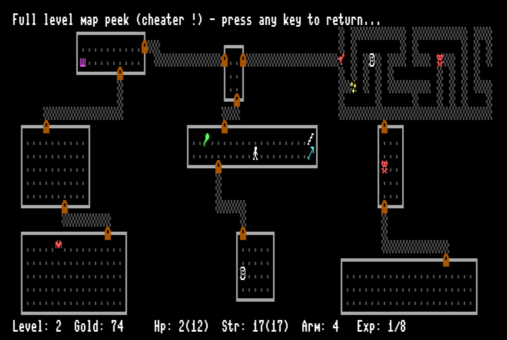

# Rogue for Commodore C128

Ported from Classic Rogue 5.4.4: https://github.com/Davidslv/rogue.

## Requirements

- A Commodore C128.
- 80 column monitor.
- A disk drive (or drive emulator).

## Release files

Binaries are [here](release/)

### Build details

- Classic Rogue 5.4.4 source code is patched to compile on [Oscar64](https://github.com/drmortalwombat/oscar64) targeting C128.  
- Code and some data stay (barely !) in bank 0, while most strings and other structs are moved to bank 1.  
- I/O routines are replaced with custom C128 versions.
- Huge PETSCII and optional enhanced graphics upgrade ;-)

# LICENSE

This project is licensed under a BSD-style license. See [LICENSE.TXT](release/LICENSE.TXT) for details.

Copyright (C) 1980-1983, 1985, 1999 Michael Toy, Ken Arnold and Glenn Wichman

Portions based on work by:

Nicholas J. Kisseberth (state.c, mdport.c)
David Burren (xcrypt.c)

This is a port from:
https://github.com/Davidslv/rogue

Please add a link to this github project.

