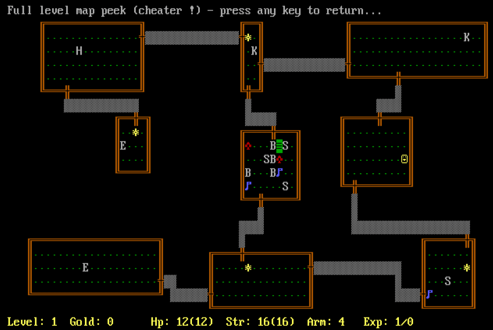
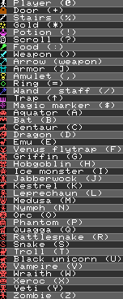

# Rogue for Commodore C128

Ported and enhanced from Classic Rogue 5.4.4: https://github.com/Davidslv/rogue.

Default "Chef's Choice" graphics and colors:

"VGA" graphics and colors:

## Requirements

- Commodore C128 (or VICE emulator).
- 80 column monitor (or RGBtoHDMI converter). See [Video Output](#Video-Output).
- Disk drive (or drive emulator).

## Release files

Binaries are [here](release/)

## Features
- Choose your graphics option between:
  - DDT's 8x8 lifelike icons ;-)  (Chef's Choice)
  - PETSCII
  - CGA
  - VGA (60 Hz interlaced, see [Video Output](#Video-Output))
- Choose your color mode between:
  - DDT's logical colors (Chef's Choice)
  - Black&White
  - MSDOS
- Full level map peek (for cheaters, won't tell you the secret key-combo).

## Documentation

The original UNIX version doc:

https://docs-archive.freebsd.org/44doc/usd/30.rogue/paper.pdf

## Items and enemies

  
Spoiler

  

## Video Output

### CRT

Any Commodore CRT monitor (e.g. 1084) should work, but I have none to test.  
Note that the "VGA" mode is actually 640x400 interlaced, so flicker is expected.  

### HDMI

There are different options to convert C128 digital RGBI to HDMI.  

I use a [RGBtoHDMI](https://github.com/hoglet67/RGBtoHDMI), this is how:
  
- For normal 640x200 graphics, select the __"Commodore 128 CGA Brown"__ profile.
  
- For "VGA" mode (actually 640x400 60 Hz interlaced):
  - Save the __"Commodore 128 CGA Brown"__ to an alternate configuration.
  - Press F1 in the game until "VGA" mode is set.
  - Edit the alternate configuration:
    - Geometry → Video Type = Interlaced
    - Geometry → Vsync Type = Force Interlaced
    - Preferences → Normal Deinterlace = None (Weave)
    - Refresh = 60Hz
  - Don't worry if you see an unstable/incorrect image while the menu is displayed. Image should be ok (and not flickering) as soon as you exit the menu.

## Build details

- Classic Rogue 5.4.4 source code is patched to compile on [Oscar64](https://github.com/drmortalwombat/oscar64) targeting C128.  
- Code and some data stay (barely !) in bank 0, while most strings and other structs are moved to bank 1.  
- I/O routines are replaced with custom C128 versions.

# LICENSE

This project is licensed under a BSD-style license. See [LICENSE.TXT](release/LICENSE.TXT) for details.

Copyright (C) 1980-1983, 1985, 1999 Michael Toy, Ken Arnold and Glenn Wichman

Portions based on work by:

Nicholas J. Kisseberth (state.c, mdport.c)
David Burren (xcrypt.c)

This is a port from:
https://github.com/Davidslv/rogue

Please add a link to this github project.

